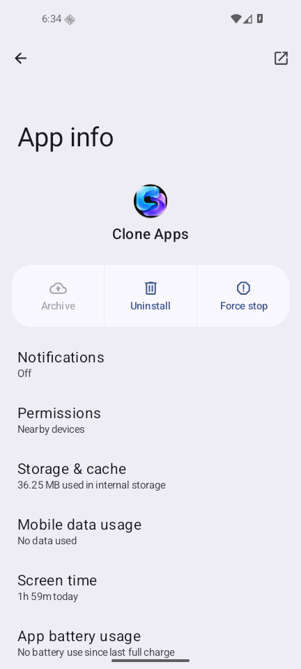

# Clone Apps



Clone Apps installs separate copies of everyday Android apps through an optional Android work profile. It also runs multiple copies of the Clone Apps Probe with separate storage and guides you through your phone’s built-in cloning options.

**[Download the signed APK · v0.5.2 prerelease](https://github.com/shreeharsh-patil/Clone-App/releases/download/v0.5.2/Clone-Apps-v0.5.2.apk)** · [Release notes](https://github.com/shreeharsh-patil/Clone-App/releases/tag/v0.5.2)

Requires **Android 13 or newer** on ARM64 or x86_64. Work-profile installation depends on Android and your device’s profile policy.

## Choose a cloning mode

| If you want to… | Use this option |
| --- | --- |
| Create one separate copy of a Play Store app already installed on your phone | **Add App → select the app → Install separate copy**. Approve work-profile setup and then tap **Install in work profile**. |
| Try two clones with independent files, preferences, and SQLite data | The released APK and a matching-signed **Clone Apps Probe**. Setup requires no root or work profile. |
| Install everyday apps in a separate Android profile | Open **Separate app setup** in Clone Apps. Android Private Space is available on eligible Android 15+ devices. Some manufacturers also offer their own cloning features. |
| Test ordinary APKs inside Clone Apps | Build the **experimental runtime** from source. Fossify Calculator and Notes launched on an Android 16 emulator. Compatibility varies by app. [Build instructions](docs/GENERAL-RUNTIME-EXPERIMENT.md#build-from-source) |

The in-app runtimes share Clone Apps’ Android UID. Android Private Space supplies an OS-level profile boundary and its own Play Store on eligible Google-certified devices. The Play Store opened inside Private Space on an emulator. Account sign-in remains unverified.

## Clone an app installed from Google Play

1. Install the app from Google Play in your personal profile.
2. In Clone Apps, tap **Add App**, select that app, and tap **Install separate copy**.
3. Select **Set up work profile** if prompted. Review Android’s profile setup, return to Clone Apps, and tap **Install in work profile**.
4. Select **Open work copy**, or open it later under **Settings → Work profile copies**.

The work copy starts with fresh app data. You can sign in inside the copy as the app allows. If Android blocks a new work profile, use the **Private Space and phone options** guide. On supported Android 15 and newer phones, unlock Private Space in All Apps and tap **Install** to use its Play Store.

## Create a probe clone

1. Install Clone Apps and the [matching-signed probe from the earlier release](https://github.com/shreeharsh-patil/Clone-App/releases/download/v0.3.0-prototype/Clone-Apps-Test-Probe-v2.apk). This probe is suitable for the storage walkthrough.
2. In Clone Apps, choose **Add App → Clone Apps Probe → Clone (1)**. The clone is added after its Activity starts successfully.
3. Repeat to create a second copy and save a different value in each. Tap a tile to reopen its instance or long-press it and choose **App Info** to open Clone Details.

Use APKs with the same signing certificate for the host and probe. For a debug build, install both debug APKs from the build steps below. If a build switch hides an existing runtime’s clones, a matching-signed build of that runtime can access its records. Existing work-profile entries appear under **Settings → Work profile copies**.

### Bluetooth

- **In Clone Apps**, open **Settings → Bluetooth devices & file sharing**. The manager supports foreground Classic and BLE discovery and hands pairing and file sharing to Android.
- **Inside a probe clone**, use the updated probe built from this repository. Open **App Info → Guest Bluetooth → Allow for this instance**, grant Android’s Nearby devices permission, then launch the clone and choose **Run BLE scan**. The fixture can attempt a Battery Level read from a compatible BLE accessory.

The Android 16 emulator confirmed that the authorized guest could register a scanner and that a second instance without consent was denied. Physical accessory discovery, pairing, and GATT data exchange still need testing. Arbitrary third-party guest Bluetooth is unsupported. [Bluetooth evidence and capability matrix](docs/RUNTIME-REPAIR.md#capability-matrix)

## Build from source

Install JDK 17, Android SDK Platform 36, Build Tools 36.0.0, Platform Tools, NDK 27.1.12297006, and Rust via rustup. Set `ANDROID_HOME` to the SDK directory. The repository pins the [Rust toolchain](rust-toolchain.toml).

**Linux**

```sh
bash scripts/build-rust.sh
./gradlew :app:assembleDebug :app:assembleDebugAndroidTest :isolation-probe:assembleDebug
```

**Windows PowerShell**

```powershell
.\scripts\build-rust.ps1
.\gradlew.bat :app:assembleDebug :app:assembleDebugAndroidTest :isolation-probe:assembleDebug
```

Install the debug pair on a test device with ADB and USB debugging enabled.

```sh
adb install -r app/build/outputs/apk/debug/app-debug.apk
adb install -r isolation-probe/build/outputs/apk/debug/isolation-probe-debug.apk
```

Use `:app:assembleRelease` for the minified release build. See [release signing](docs/SIGNING.md) for producing an APK that can update a published installation.

## Run the tests

The APK verifier and device harness require Python 3.

```sh
cargo test --manifest-path rust-core/Cargo.toml --locked
./gradlew :app:testDebugUnitTest :app:lintDebug
python3 scripts/verify-apk.py app/build/outputs/apk/debug/app-debug.apk
```

On a disposable emulator, run the device suite to verify clone isolation, recovery after reboot, and APK replacement. Use the serial and API level of your test device.

```sh
python3 scripts/test-virtual-runtime.py --serial emulator-5556 --api 36 --reboot --host-update
```

The harness saves screenshots, logs, and APK hashes under `build/virtual-evidence/`. To test a probe upgrade, save the version 1 APK and build a second APK with `-PprobeVersionCode=2`. Pass the two files with `--probe-apk` and `--guest-update-apk`. [Android 13–16 CI run](https://github.com/shreeharsh-patil/Clone-App/actions/runs/43726540199)

## Project documentation

[Runtime architecture](docs/VIRTUAL-RUNTIME.md) · [Audit and feature limits](docs/RUNTIME-REPAIR.md) · [Legacy work-profile recovery](docs/LEGACY-WORK-PROFILE.md)

Clone Apps is licensed under [Apache 2.0](LICENSE). See [NOTICE](NOTICE) for attribution.
