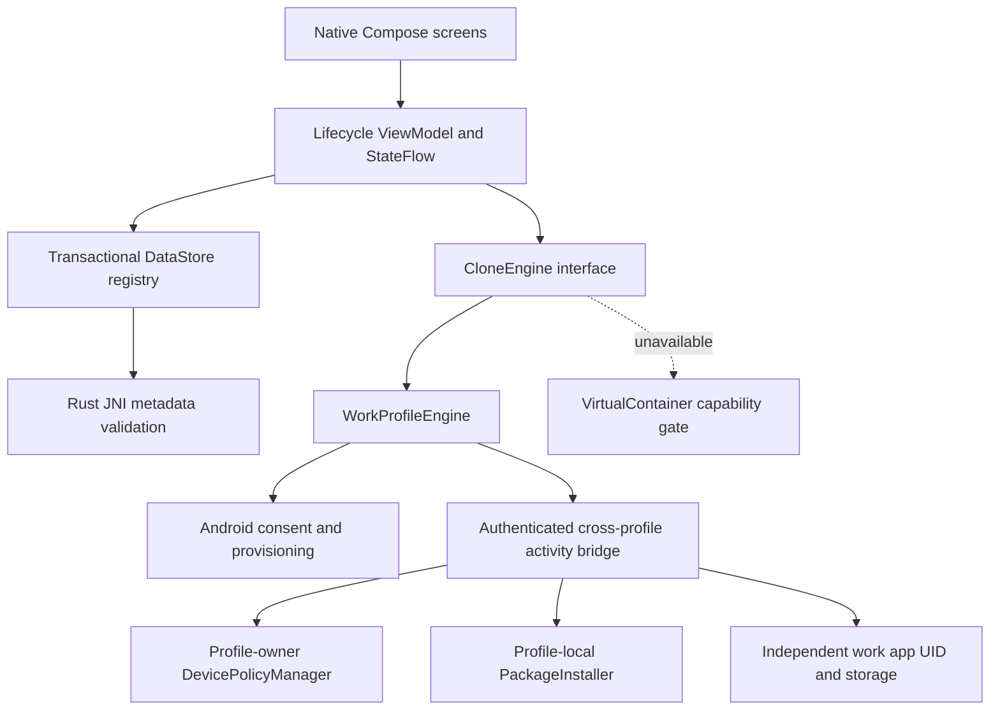
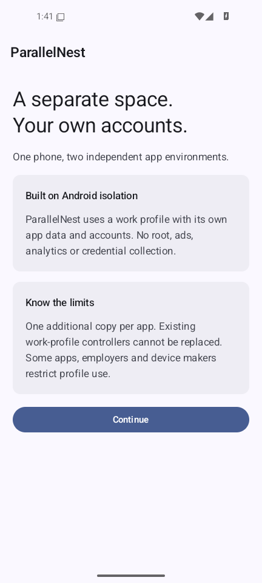
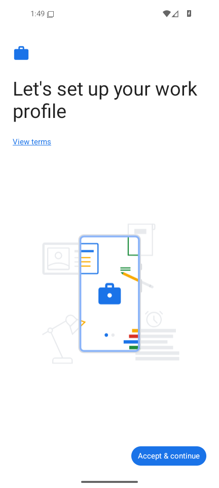
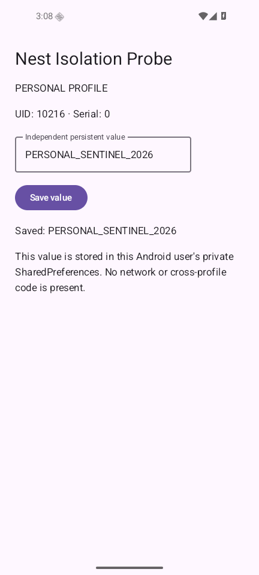
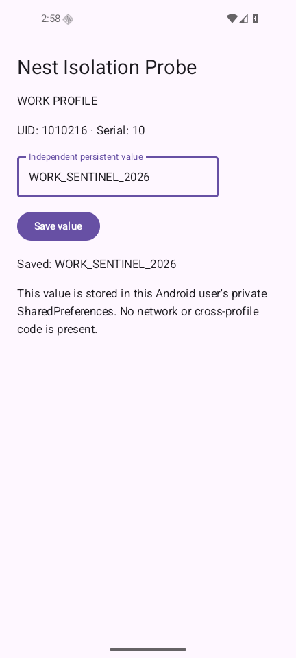
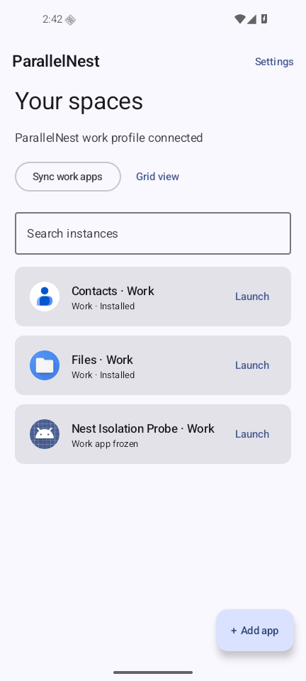

# ParallelNest

An original, free Android work-profile app manager written in Kotlin, Jetpack Compose and Rust. No ads, no analytics, no account with us, and no root requirement. Android provides a separate profile sandbox for a second installed copy of an application.

**Alpha software. One additional copy per package.** Virtual containers are disabled because none of the investigated engines passed the licensing, security and Android compatibility gates. See [feasibility/source review](docs/FEASIBILITY.md) and [executed test results](docs/TEST-RESULTS.md). A successful build alone is not a stable-release certification.

## Download and install

APKs and complete corresponding source are published to [GitHub Releases](https://github.com/shreeharsh-patil/Clone-App/releases). For local builds, install `app/build/outputs/apk/debug/app-debug.apk` with Android's installer or `adb install -r`. The debug APK supports ARM64 phones and x86_64 emulators. The separate `isolation-probe/build/outputs/apk/debug/isolation-probe-debug.apk` is a first-party test app; it is not bundled in the manager.

Allow installation from your chosen file browser when Android asks. Open ParallelNest, read the profile explanation, check consent, and accept Android's profile setup screen. Then select **Add app** and confirm installation in the work profile. Work app accounts begin empty. To verify separation, save different values in the original and work copies of Nest Isolation Probe.

An existing work profile is never replaced. If another controller owns your profile, keep using it or make a deliberate choice in Android settings; removing a profile permanently deletes all of its app data. ParallelNest does not implement a profile-wipe button. Pause/resume a work profile in Android settings or Quick Settings.

Debug signing is for evaluation. Debug builds permit work-profile ADB debugging when system USB debugging is enabled, for isolation tests; production builds retain Android's default profile debugging restriction. APK updates require the same signing certificate. Do not replace the signing identity of an installed profile controller. An **unsigned** release APK is not installable until signed; production signing secrets are described below.

## What is implemented

- System-managed provisioning, permission explanations and explicit consent.
- Installed launcher-app discovery using scoped package-visibility queries.
- Base/split APK installation into the managed profile, authenticated cross-profile launching, profile-app synchronization, suspend/resume and work-only uninstallation.
- Search, lazy grid/list dashboard, original app icons, custom names, icon framing, Android launcher shortcuts, timestamps and profile status.
- Rename, Android work-app information/storage controls, deletion confirmation, lock before each manager launch and automatic relocking.
- Biometric/device-credential authentication plus optional PIN fallback. Salted PBKDF2-HMAC-SHA256 verifier, Android Keystore AES-GCM encryption and retry delays. No plaintext PIN persistence.
- Light/dark/system themes, Material You dynamic colors, edge-to-edge insets and native Compose navigation.
- Manager-only metadata/settings backup and restore through Android's file picker, privacy screen, compatibility diagnostics, diagnostic export and complete dependency license viewer.
- Native Rust schema/identifier/package validation, bounded import, strict serialization and duplicate-environment rejection, with tests and two JNI ABIs.

The app lock protects launches through ParallelNest and its shortcuts. It cannot block a work app launched through another launcher or notification. Suspending an application uses Android's package suspension policy; it is not an unrestricted force-stop facility. Android may refuse suspension of critical packages. Launching through ParallelNest resumes a suspended work app.

## Architecture



The personal-profile registry is the single source of truth for manager metadata. Actual displayed installations are reconciled with profile-specific LauncherApps records; removed apps/profiles are not presented as runnable copies. Registry entries survive app updates; profile serial IDs prevent mapping old entries onto a new profile. Stale metadata can remain for recovery without showing a nonexistent installation. Each package/profile pair appears once.

Small codebase, two Gradle modules: `app` and `isolation-probe`. Inside `app`, `core` owns models/persistence/security, `engine` owns provisioning/installation/launching and `ui` owns Compose screens and ViewModel. Rust validates metadata rather than duplicating Android lifecycle APIs. DataStore is sufficient for the bounded registry and avoids a second Room database needing reconciliation. Native calls, discovery, serialization and APK streaming run off the UI thread. There are no persistent background services or polling loops.

## Compatibility

| Android | API | Build/API support | Executed isolation tests |
| --- | --- | --- | --- |
| 13 | 33 | Minimum supported version; work-profile APIs available | See test report / CI; no unrecorded execution claim |
| 14 | 34 | Supported APIs; activity-start restrictions accounted for | See test report / CI |
| 15 | 35 | Creator PendingIntent opt-in; 16 KiB native/APK alignment | See test report / CI |
| 16 | 36 | Compile and target SDK; native edge-to-edge UI | Android 16 x86_64 emulator, as recorded in test report |

ARM64 native libraries are built and packaged; physical ARM64/OEM testing remains a release gate until evidence is recorded. Device policy, OEM restrictions, unavailable package APK files, paused profiles, profile conflicts, unsupported activity handlers and package-installation errors are reported to users. Popular third-party apps are compatibility targets, not guaranteed support entries. Notifications retain Android work-profile behavior and each app's notification permission; no mirroring or virtual notification support is claimed.

## Build on Windows / Android Studio

Prerequisites: Java 17, Android Studio, Android SDK platform 36, build tools 36.0.0, NDK **27.1.12297006**, Python 3 and Rust **1.99.0**. Set `ANDROID_HOME` and `JAVA_HOME`, accept SDK licenses, and open this repository in Android Studio.

```powershell
rustup toolchain install 1.99.0
rustup target add aarch64-linux-android x86_64-linux-android
cargo test --manifest-path rust-core/Cargo.toml --locked
./scripts/build-rust.ps1
./gradlew.bat :app:assembleDebug :isolation-probe:assembleDebug :app:testDebugUnitTest :app:lintDebug
python scripts/verify-apk.py app/build/outputs/apk/debug/app-debug.apk
```

The default Windows Rust host needs Visual Studio C++ Build Tools. A MinGW installation can instead use the `1.99.0-x86_64-pc-windows-gnu` toolchain with `RUSTUP_TOOLCHAIN` set for the command session. Install both Android targets on that toolchain. The native build script accepts `-Ndk` to point at an alternate NDK location; use the pinned version for reproducibility. Source-controlled Gradle wrapper and Cargo.lock pin the build. `app:preBuild` intentionally fails if either JNI ABI is missing.

## Build on Ubuntu

```bash
rustup show
cargo test --manifest-path rust-core/Cargo.toml --locked
bash scripts/build-rust.sh
chmod +x gradlew
./gradlew :app:assembleDebug :isolation-probe:assembleDebug :app:testDebugUnitTest :app:lintDebug
python3 scripts/verify-apk.py app/build/outputs/apk/debug/app-debug.apk
```

Set `ANDROID_HOME`; optionally set `ANDROID_NDK_HOME` to the pinned NDK. The shell script uses the NDK's Android clang linkers directly, so cargo-ndk is not required. Both ELF segment alignment and APK zip alignment are checked at 16 KiB. The Java/JNI entry point is retained through R8.

## Tests and reproducibility

Run `./gradlew :app:connectedDebugAndroidTest` with a disposable emulator/test device. Set `ANDROID_SERIAL` when multiple devices are connected. Instrumentation exercises native schema rejection, Keystore encryption, PIN verification/retry delay, forged bridge rejection and the native Compose interface. Rust tests cover duplicate IDs/environment pairs, traversal/malformed packages, schema/field rejection, size bounds, invalid profile and serialization.

The manual isolation protocol and execution evidence are in [docs/TEST-RESULTS.md](docs/TEST-RESULTS.md). Only the first-party probe's debug private preferences are inspected during tests; the production manager never extracts guest private data. Screenshots below come from the actual running emulator, not mockups.

| Onboarding | Android consent |
| --- | --- |
|  |  |

| Personal probe: UID 10216 | Work probe: UID 1010216 |
| --- | --- |
|  |  |



## CI and release signing

`.github/workflows/android.yml` builds both Rust Android targets, runs Rust/Kotlin tests and lint, builds debug and unsigned release APKs, verifies native alignment, uploads artifacts, and runs Android instrumentation on API 33/34/35/36 emulators. A `v*` tag publishes a **prerelease** with APKs and corresponding source only after build and instrumentation jobs succeed. CI execution status is separate from local results.

Repository release secrets:

- `ANDROID_KEYSTORE_BASE64`: base64 encoded release keystore.
- `ANDROID_KEYSTORE_PASSWORD`: store password.
- `ANDROID_KEY_ALIAS`: signing alias.
- `ANDROID_KEY_PASSWORD`: key password.

Without these secrets, releases provide an installable **debug** APK and a clearly named **unsigned** release artifact. GitHub runners may generate different debug certificates between runs, so debug APKs are not a production update channel. Protect and consistently use one release signing identity for updateable production distribution. No release keystore/password is checked into the repository. Local release signing can use `SIGNING_STORE_FILE`, `SIGNING_STORE_PASSWORD`, `SIGNING_KEY_ALIAS` and `SIGNING_KEY_PASSWORD` environment variables.

## Privacy, limits and licensing

No INTERNET, QUERY_ALL_PACKAGES, broad storage, accessibility-service, VPN, usage-access or notification-listener permission. Package installation/deletion and biometric permissions are justified by explicit user actions. The manager cannot back up arbitrary app data, read guest private caches, guarantee third-party account acceptance, evade Integrity checks, host unlimited virtual copies or silently take over an existing controller.

Original project: Apache-2.0. [NOTICE](NOTICE), [license distribution](licenses/README.md), [complete runtime dependency notices](app/src/main/assets/third-party-notices.txt). Island and Shelter informed the source review; no GPL or proprietary engine was copied or linked. BlackBox/NewBlackbox/VirtualApp are not included. Changes to dependencies must regenerate and review the notices before release.
